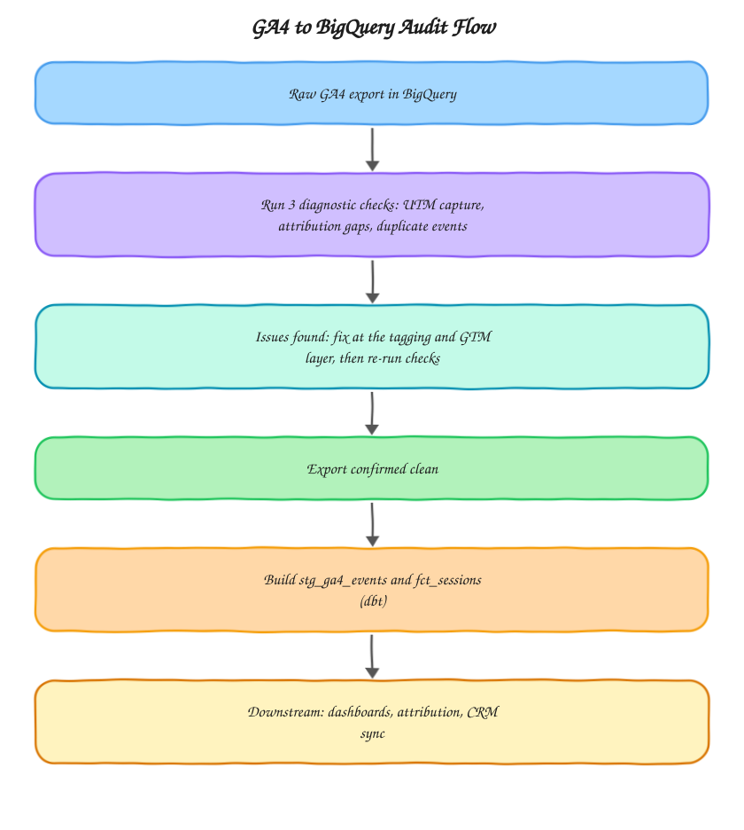

# GA4 → BigQuery Audit Toolkit

A set of SQL queries and dbt models I use when auditing a client's GA4 to BigQuery export. Real client data never leaves the client's warehouse, so this repo uses anonymized, representative patterns instead. It exists to show the kind of checks and models behind the audits I run at [motabar.builds.stuff](https://motabarbuildstuff.com/).

## Why this exists

Most GA4 to BigQuery setups look fine on the surface and fall apart once you check three things: whether UTM parameters are actually being captured, whether sessions are getting attributed to the right source, and whether events are firing twice. Any one of these silently inflates or deflates the numbers a business is making decisions on, and none of them show up in the GA4 UI itself, they only surface once you're looking directly at the exported event data in BigQuery.

## Architecture

The loop back from "issues found" to the raw export matters: this toolkit is written on the assumption that you never model on top of a dirty export. Every fix happens at the tagging layer first, and the diagnostic queries get re-run before any dbt model is trusted.

## What's in here

**sql/** holds standalone diagnostic queries you can run directly against a GA4 BigQuery export, no dbt project required.

* `utm_capture_check.sql` finds sessions where campaign traffic arrived but GA4 never captured the campaign parameter
* `session_attribution_gaps.sql` flags sessions where source or medium is missing or changes mid-session
* `duplicate_event_check.sql` catches events firing more than once per session, a common cause of inflated conversion counts

**dbt_models/** holds the staging and fact layer that gets built once the raw export passes all three checks.

* `stg_ga4_events.sql` flattens and types the raw nested GA4 export, one row per event
* `fct_sessions.sql` rolls events up into a session level fact table with first touch attribution and basic engagement signals

## How I use this in practice

An audit starts with the three diagnostic queries, since they surface concrete issues fast without needing a full pipeline in place. Each query is written to be run as-is against a client's export with only the project and dataset placeholders swapped, and the results go straight into the audit report. Once the export passes all three checks, the dbt models in `dbt_models/` become the base layer the client's warehouse gets built on, and dashboards, attribution reports, and CRM syncs all sit on top of `fct_sessions` rather than querying raw events directly.

## What "clean" looks like

* `utm_capture_check.sql` returns zero rows, meaning every session with a campaign parameter in the URL actually has that campaign captured in GA4
* `session_attribution_gaps.sql` returns zero rows, meaning no session has more than one source or medium value across its events
* `duplicate_event_check.sql` returns zero rows for revenue-relevant events like `purchase` and `generate_lead`

Anything else is a finding that goes into the fix order table of the audit.

## Setup

1. Update the project and dataset placeholders (`project.analytics_XXXXXXXX`) in each SQL file to match the client's actual GA4 export location
2. Run the three diagnostic queries directly in BigQuery
3. Once clean, point a dbt project at this repo's `dbt_models/` directory and configure the `ga4` source in your `sources.yml`

## Stack

BigQuery, dbt, SQL

## Related

* Service: [Free GA4 health check](https://motabarbuildstuff.com/ga4-health-check/)
* Guide: [Why is my GA4 direct traffic so high?](https://motabarbuildstuff.com/blog/why-is-ga4-direct-traffic-so-high/)
* Guide: [How much does a GA4 setup cost in 2026?](https://motabarbuildstuff.com/blog/how-much-does-ga4-setup-cost/)
* Service: [GA4 audit and repair](https://motabarbuildstuff.com/ga4-setup-consultant/)

Built by [Motabar Javaid](https://motabarbuildstuff.com/about/), analytics engineer at [motabar.builds.stuff](https://motabarbuildstuff.com/).
